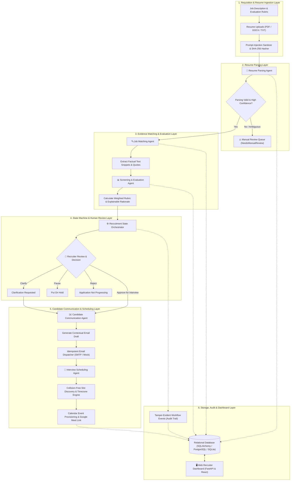
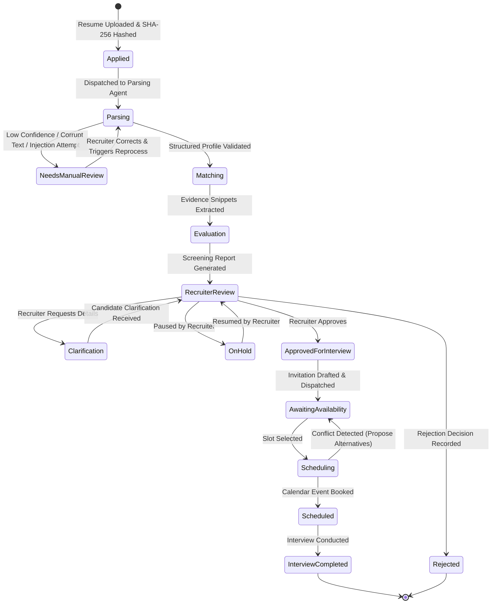
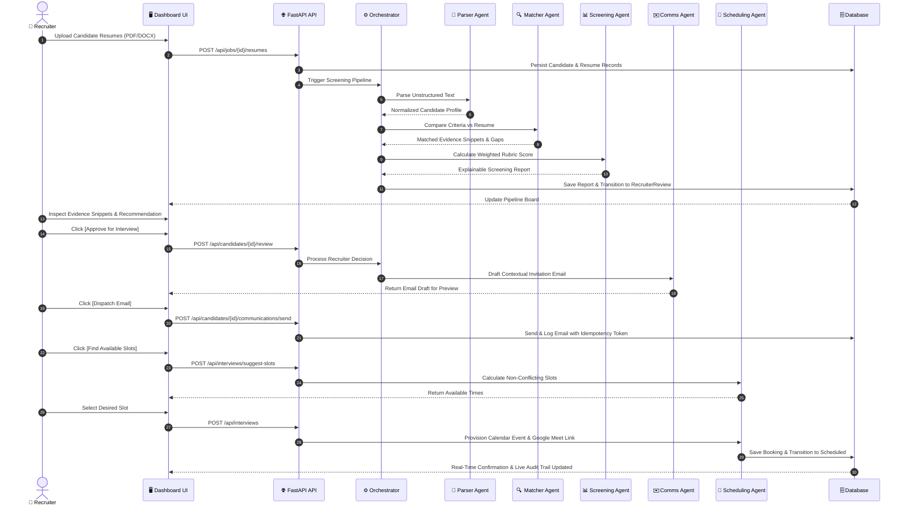

# AI Recruitment Agent Team
## End-to-End Resume Screening to Interview Scheduling Multi-Agent System

An enterprise-grade, multi-agent AI hiring platform designed to automate and augment the recruitment lifecycle—from job requisition intake and resume parsing to evidence-based candidate screening, human recruiter review, automated candidate communications, and conflict-free interview scheduling.

The system employs specialized AI agents orchestrated by a centralized state machine. It is architected strictly under **Responsible AI and Human-in-the-Loop (HITL)** principles: AI agents provide explainable decision support, while human recruiters retain authority over all consequential hiring determinations.

---

## 🏗️ High-Level System Architecture

The following diagram illustrates the complete end-to-end dataflow, showing how candidate resumes traverse specialized agent layers, the state engine, persistence, external integrations, and the recruiter dashboard:



---

## 🔄 Candidate Lifecycle State Machine

The recruitment pipeline operates as a deterministic, observable finite state machine with persistent checkpoints to support safe resumption, idempotency, and retries:



---

## 🤝 Human-in-the-Loop Sequence Diagram

Recruiters retain full visibility and control over consequential actions. The AI agents act as an autonomous co-pilot that drafts, evaluates, and verifies before requesting approval:



---

## 🤖 Detailed Agent Responsibilities & Prompt Engineering

The system partitions hiring responsibilities across five distinct, focused agents:

| Agent | Responsibility | Core Technology & Model | Safety & Guardrails |
|---|---|---|---|
| **Resume Parser Agent** | Extracts structured fields (skills, experience years, education, projects, contact info). | LLM + Regex/NLP Heuristics (`pypdf`, `python-docx`) | Prompt-injection mitigation, control-token stripping, zero fact hallucination. |
| **Job Matcher Agent** | Maps candidate profile against required and preferred criteria with evidence quotes. | Text snippet extraction + Semantic similarity | Distinguishes "not found in resume" from "lacks skill". |
| **Screening & Evaluation Agent** | Applies job-specific rubric weights to calculate composite match score and explainable recommendation. | Weighted scoring engine + LLM explanation | **Zero scoring of protected demographic attributes** (EEOC/GDPR aligned). |
| **Candidate Communication Agent** | Drafts personalized, empathetic emails for recruiter review and dispatch. | Templating engine + LLM personalization | Bounded claims, no unauthorized promises, strict idempotency keys. |
| **Interview Scheduling Agent** | Discovers open slots, avoids double-booking, manages time zones, and creates meeting links. | Calendar logic engine + Collision detection | Atomic slot reservation, idempotent booking tokens. |

### Centralized Prompts Architecture
All system prompts are modularized under `backend/prompts/`:
- `parser_prompts.py`: Directs strict schema adherence and untrusted input isolation.
- `matcher_prompts.py`: Instructs quotation extraction and distinction between missing evidence and absent skills.
- `screening_prompts.py`: Implements bias-free rubric weighting.
- `comms_prompts.py`: Governs tone, professional boundaries, and candidate respect.

---

## 🗄️ Database Architecture & Relational Schema

Implemented in SQLAlchemy ([`backend/database/models.py`](file:///Users/iitian/Desktop/FOR%20CLAUDE/newww%20instagram%20vale/Al%20Recruitment%20Agent%20Team%20/backend/database/models.py)), supporting both PostgreSQL and SQLite:

| Table | Primary Key | Foreign Keys | Key Attributes & Responsibilities |
|---|---|---|---|
| `jobs` | `id (String)` | — | `title`, `description`, `required_skills`, `preferred_skills`, `min_experience_years`, `rubric`, `workflow_config`. |
| `candidates` | `id (String)` | `job_id` | `name`, `email`, `phone`, `status` (Finite state tracker), `created_at`. |
| `resumes` | `id (String)` | `candidate_id` | `file_path`, `filename`, `file_type`, `file_hash` (SHA-256), `parsing_status`, `raw_text`. |
| `candidate_profiles` | `id (String)` | `candidate_id` | Structured extracted data: `skills`, `experience_years`, `education`, `certifications`, `projects`, `needs_manual_review`. |
| `matching_reports` | `id (String)` | `candidate_id`, `job_id` | `matched_requirements` (with evidence quotes), `missing_or_unclear_requirements`, `match_score`, `rubric_breakdown`, `recommendation`. |
| `review_decisions` | `id (String)` | `candidate_id` | Recruiter human-in-the-loop audit: `recruiter_name`, `decision`, `notes`, `overridden`. |
| `communications` | `id (String)` | `candidate_id` | `template_type`, `recipient_email`, `subject`, `body`, `status`, `idempotency_key`, `sent_at`. |
| `interviews` | `id (String)` | `candidate_id` | `interviewer_email`, `start_time`, `end_time`, `meeting_link`, `calendar_event_id`, `status`. |
| `workflow_events` | `id (String)` | `candidate_id`, `job_id` | Immutable audit stream: `previous_status`, `new_status`, `actor_type`, `event_type`, `details`, `timestamp`. |
| `integration_tokens` | `id (String)` | — | OAuth / calendar integration credentials. |

---

## 🌐 Complete REST API Specification

### Requisitions & Resumes (`/api/jobs`)
- `POST /api/jobs`: Create a new job requisition with rubric weighting.
- `GET /api/jobs`: List all active job openings with applicant counts.
- `GET /api/jobs/{id}`: Retrieve job requisition details.
- `POST /api/jobs/{id}/resumes`: Multipart upload for batch resumes (PDF/DOCX/TXT). Automatically initiates the multi-agent screening workflow.

### Candidates & Screening (`/api/candidates`)
- `GET /api/candidates`: List candidates with filters (`job_id`, `status`).
- `GET /api/candidates/{id}`: Retrieve candidate details, parsed profile, and score.
- `GET /api/candidates/{id}/report`: Retrieve the evidence-based screening report and provenance quotes.
- `POST /api/candidates/{id}/review`: Record recruiter review decision (`approved`, `clarification_requested`, `on_hold`, `rejected`).
- `POST /api/candidates/{id}/reprocess`: Re-trigger agent screening pipeline.
- `POST /api/candidates/{id}/availability`: Submit candidate preferred availability.

### Communications (`/api/candidates/{id}/communications`)
- `POST /api/candidates/{id}/communications/draft`: Generate contextual email draft via Communication Agent.
- `POST /api/candidates/{id}/communications/send`: Idempotently dispatch email.
- `GET /api/candidates/{id}/communications`: List candidate message history.

### Interviews & Scheduling (`/api/interviews`)
- `POST /api/interviews/suggest-slots`: Calculate available, non-conflicting calendar slots.
- `POST /api/interviews`: Book confirmed interview with meeting link and idempotency token.
- `PATCH /api/interviews/{id}`: Reschedule, cancel, or mark interview completed.
- `GET /api/interviews`: List scheduled interviews.

### Operational Dashboard (`/api/dashboard`)
- `GET /api/dashboard/summary`: Aggregated funnel statistics, average match scores, flagged candidates count, and real-time audit event feed.

---

## 🔒 Security, Privacy & Responsible AI Safeguards

1. **Prompt-Injection Mitigation**: Resumes are untrusted external input. The system strips control tokens, limits text bounds, isolates resume contents within data delimiters, and neutralizes phrases attempting prompt redirection.
2. **Fairness & Demographic Neutrality**: Scoring algorithms strictly evaluate job-related qualifications, demonstrable experience, and project outputs. Name, age, gender, ethnicity, disability, and appearance are completely excluded from scoring.
3. **Evidence-Based Transparency**: The system refuses to output unexplained, black-box numerical scores. Every rating is accompanied by verbatim quotes demonstrating where the resume substantiates the requirement.
4. **Human-in-the-Loop Safeguards**: AI recommendations never execute irreversible rejections or automatic interview invitations without recruiter authorization.
5. **Idempotency & Replay Protection**: External integrations (email dispatching and calendar booking) enforce UUID idempotency keys to eliminate double-booking and duplicate messaging on retried tasks.

---

## 🚀 Quick Start Guide

### 1. Prerequisites
- Python 3.9+
- Node.js (Optional, only for React development; the dashboard is self-served by default)

### 2. One-Click Launch Script
Execute the provided launch script to automatically configure the environment, run automated tests, seed realistic demo data, and start the platform:

```bash
./run.sh
```

### 3. Manual Step-by-Step Setup
```bash
# 1. Activate virtual environment
source backend/venv/bin/activate

# 2. Run automated test suite
PYTHONPATH="." pytest backend/tests -v

# 3. Seed realistic jobs and candidates
PYTHONPATH="." python backend/seed_data.py

# 4. Start the FastAPI Application
PYTHONPATH="." python backend/main.py
```

### 4. Access Web Interfaces
- **Recruiter Dashboard**: [http://localhost:8000](http://localhost:8000)
- **Interactive Swagger Documentation**: [http://localhost:8000/docs](http://localhost:8000/docs)
- **Alternative ReDoc Documentation**: [http://localhost:8000/redoc](http://localhost:8000/redoc)
- **System Health Endpoint**: [http://localhost:8000/health](http://localhost:8000/health)

---

## 🐳 Docker Deployment

The application includes container definitions for production environments:

```bash
# Build and run using Docker Compose
docker compose up --build
```

---

## 🧪 Automated Testing

The test suite covers prompt-injection sanitization, heuristic and LLM parsing, evidence-based matching, state machine progression, and idempotency:

```bash
PYTHONPATH="." pytest backend/tests -v
```

Expected output:
```text
backend/tests/test_matching.py::test_job_matcher_and_screening PASSED
backend/tests/test_orchestrator.py::test_recruitment_orchestrator_flow PASSED
backend/tests/test_parsing.py::test_resume_service_sanitization PASSED
backend/tests/test_parsing.py::test_resume_parser_heuristic PASSED
============================== 4 passed in 0.28s ===============================
```

---

## 📂 Repository File Tree

```text
ai-recruitment-agent-team/
├── backend/
│   ├── main.py                     # FastAPI application entry point & dashboard mount
│   ├── seed_data.py                # Database population script with realistic candidates
│   ├── requirements.txt            # Python dependencies (FastAPI, SQLAlchemy, PyPDF, etc.)
│   ├── Dockerfile                  # Container build specification
│   ├── core/
│   │   ├── __init__.py
│   │   └── config.py               # Settings, environment variables & file directories
│   ├── database/
│   │   ├── __init__.py
│   │   ├── session.py              # Database engine & sessionmaker
│   │   └── models.py               # 10 relational data models
│   ├── schemas/                    # Pydantic v2 data validation contracts
│   │   ├── __init__.py
│   │   ├── job.py                  # Job schemas
│   │   ├── candidate.py            # Candidate & parsed profile schemas
│   │   ├── screening.py            # Matching report & review schemas
│   │   ├── communication.py        # Email draft & send schemas
│   │   ├── interview.py            # Interview scheduling schemas
│   │   └── dashboard.py            # Dashboard metrics & audit schemas
│   ├── prompts/                    # Modularized Agent System Prompts
│   │   ├── __init__.py
│   │   ├── parser_prompts.py       # Resume extraction prompts & untrusted input directives
│   │   ├── matcher_prompts.py      # Evidence quote mapping prompts
│   │   ├── screening_prompts.py    # Anti-bias rubric scoring prompts
│   │   └── comms_prompts.py        # Empathetic email generation prompts
│   ├── services/                   # Foundation integration services
│   │   ├── __init__.py
│   │   ├── resume_service.py       # PDF/DOCX extractor & prompt-injection defense
│   │   ├── llm_service.py          # LLM provider with fallback heuristic engine
│   │   ├── email_service.py        # Email templating & outbox dispatcher
│   │   └── calendar_service.py     # Slot calculator, conflict checker & booking engine
│   ├── agents/                     # Specialized AI Agents
│   │   ├── __init__.py
│   │   ├── resume_parser.py        # Resume Parsing Agent
│   │   ├── job_matcher.py          # Job Matching Agent (Evidence quote extraction)
│   │   ├── screening_agent.py      # Screening & Evaluation Agent (Rubric calculation)
│   │   ├── communication_agent.py  # Candidate Communication Agent
│   │   └── scheduling_agent.py     # Interview Scheduling Agent
│   ├── orchestrator/               # State Machine & Process Management
│   │   ├── __init__.py
│   │   └── recruitment_graph.py    # State coordinator, checkpointing & audit trail
│   ├── api/                        # REST API Routers
│   │   ├── __init__.py
│   │   ├── jobs.py                 # Job requisition endpoints
│   │   ├── candidates.py           # Candidate intake & report endpoints
│   │   ├── screening.py            # Recruiter review & communication endpoints
│   │   ├── interviews.py           # Interview booking endpoints
│   │   └── dashboard.py            # Dashboard summary endpoints
│   └── tests/                      # Automated Test Suite
│       ├── __init__.py
│       ├── test_parsing.py         # Parser & sanitization unit tests
│       ├── test_matching.py        # Evidence matcher & rubric unit tests
│       └── test_orchestrator.py    # State machine & idempotency integration tests
├── frontend/
│   ├── index.html                  # Recruiter Dashboard single-page web app
│   ├── package.json                # Frontend package configuration
│   ├── vite.config.js              # Vite bundler & API proxy configuration
│   └── src/                        # Modular React Source Code
│       ├── main.jsx                # React root mount
│       ├── App.jsx                 # Top-level React container
│       ├── index.css               # Styling definitions
│       ├── api.js                  # Frontend API service client
│       └── components/             # Reusable UI Components
│           ├── MetricsCards.jsx    # Funnel KPI summary cards
│           ├── CandidateTable.jsx  # Candidate pipeline table
│           ├── CandidateDrawer.jsx # Evidence inspector & decision modal
│           └── JobModal.jsx        # Job opening creation modal
├── docker-compose.yml              # Container orchestration
├── run.sh                          # Automated one-click execution script
├── .env.example                    # Environment configuration template
├── .env                            # Active local development settings
├── .gitignore                      # Version control exclusions
└── README.md                       # Comprehensive system documentation
```
